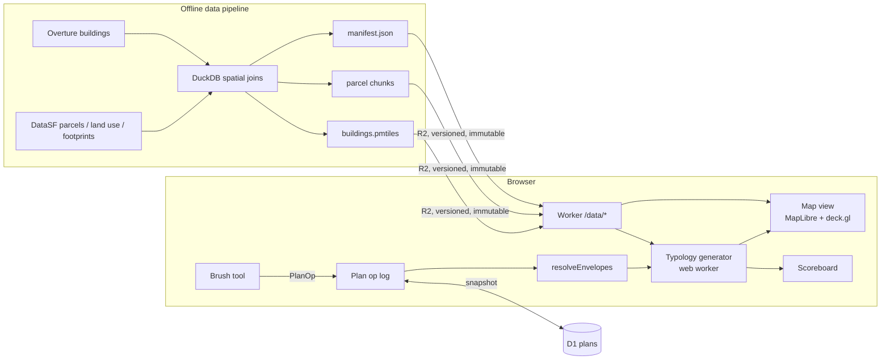

# SF Housing Simulator — Composition Design

Status: **approved with amendments** (2026-10-10). OD-0..OD-7 accepted; R9–R10 added. This document is the discussion
surface; edit it directly. Approval of this doc is the gate before per-subsystem
specs are derived.

## Goal

A free, open-source, browser-based 3D map of San Francisco where anyone can
change how much residential building is allowed, and where, and watch the city
fill in, with the aim of reaching the housing target. It is built in three
learning stages, in this order:

1. **Feel the scale** — direct manipulation. You paint allowed height onto the
   city and buildings appear. *(Milestone 1, this package.)*
2. **Understand tradeoffs** — indirect manipulation. Area selections, a
   "likely buildout" view next to "theoretical capacity", and consequence
   readouts.
3. **Test real policy** — load the actual plans (current zoning, the 2025
   Family Zoning Plan), add permitting time, add levers that influence
   permitting, and overlay the real development pipeline.

People can save their plans and share them.

**This package specs Milestone 1 only.** Milestones 2–5 are carried as *typed
seams* in the interface table, so that later work extends M1 rather than
rewriting it.

### Milestone 1 in one paragraph

You get a 3D map of SF showing today's buildings. You pick a height ("6
stories") and a brush size, then paint over the city. Every eligible parcel
under the brush immediately gets a generated building, drawn from a small
typology table: ADU, plex, walk-up, 5-over-1, mid-rise or tower, chosen by the
painted height and the lot. Each parcel also gets some seeded variety, so a
block doesn't look cloned. Painting a lower height, or erasing, removes the
generated buildings. A scoreboard shows the **net** new units against SF's
6th-cycle RHNA target of **82,069** units, and against 94,379 once the state's
15% buffer is added. A plan is the list of your brush strokes. It autosaves
locally and can be published to a short share link.

## Subsystems (Milestone 1)

| slug | scope |
|---|---|
| `platform` | Scaffold the new repo following the planafoot conventions, without planafoot's scale. Includes: SvelteKit 2 + Svelte 5 + Tailwind 4 on Vite 8; Drizzle 1.0 rc with `@planafoot/drizzle-cf-migrations`; npm; Vitest with client and server projects; Playwright e2e with an axe gate. Docs follow the CLAUDE.md index plus `docs/dev/*.md` and the `docs/superpowers/{design,specs,plans}` layout. Bindings: D1 `DB`, R2 `BUCKET` and one rate-limit binding. No Durable Objects, KV or auth in M1. Staging auto-deploys on push to main; prod deploys via release-please. Serves R2 data at `/data/<datasetVersion>/*` with HTTP range support (for PMTiles) and immutable caching. Publishes LICENSE and data-attribution pages. |
| `data-pipeline` | Reproducible offline build in `pipeline/` that turns public sources into versioned static artifacts. Uses DuckDB (spatial extension) SQL, tippecanoe and a small Node orchestrator. Fetches sources, joins buildings and land use to parcels, classifies eligibility, writes `buildings.pmtiles`, parcel chunks, `neighborhoods.geojson` and `manifest.json`, then uploads them to R2 under a new `datasetVersion`. Owns invariant checks such as existing-unit totals and join coverage. |
| `plan-model` | Pure TypeScript domain core with no DOM or map dependencies. Contains the `Plan` / `PlanOp` types, `resolveEnvelopes`, (de)serialization and schema versioning. Stores strokes, not parcel lists, so a plan stays valid across dataset versions. |
| `typology-generator` | Pure TypeScript, run in a web worker. Given a `ParcelRecord`, an `Envelope` and a seed, it returns a `GeneratedBuilding` or `null`. It holds the typology table, the massing rules (lot coverage, setbacks, stepbacks, floor-to-floor heights), the unit-yield formula and the seeded variety. Deterministic. |
| `map-view` | The MapLibre GL map. The basemap is a Protomaps SF extract on R2. Existing buildings render from `buildings.pmtiles` as `fill-extrusion`. Buildings on replaced parcels are hidden with a filter or feature-state keyed by `parcelId`. A deck.gl `MapLibreOverlay` from `@deck.gl/maplibre` (interleaved) `SolidPolygonLayer` draws the generated building parts, with a short rise-in animation. |
| `brush-tool` | Pointer and touch interaction that emits `BrushStroke` ops: paint or erase, a stories value, and a radius. Includes the brush cursor ring, an explicit pan/paint mode switch on touch devices, undo/redo over the op log, and a live preview while dragging. |
| `scoreboard` | Derived readouts: gross new units, units demolished on replaced parcels, net units, % of RHNA (82,069) and of RHNA + buffer (94,379), parcels changed, and net units by neighborhood. Includes a short "what this number means" note: M1 is theoretical max buildout, not a forecast. |
| `plan-sharing` | Autosaves the current plan to `localStorage`. **Publish** POSTs the plan to the worker, which stores an immutable D1 row and returns a short id. `/p/<id>` loads it read-only, with a "remix" action that copies it into a new local plan. Payload size cap and rate limit. No accounts. |

### Deferred subsystems (named seams, not specced here)

| slug | milestone | plugs in via |
|---|---|---|
| `area-select` | M2 | new `AreaOp` variant in `PlanOp` (neighborhood / corridor / transit buffer) that writes the same `Envelope` |
| `buildout-likelihood` | M2 | `BuildoutMode = 'likely'`, plus `likelihood(parcel, envelope, ctx) → p`. Specific buildings are picked by a seeded threshold; expected units = Σp |
| `consequences` | M2 | additional `Scoreboard` metrics, including **affordability** (R9): an `AffordabilityModel { rentIndexAfter(netUnits, ctx): number; unitsToReach(goal: AffordabilityGoal): number }`. It estimates the price/rent response to net supply, then the unit count needed to restore a goal (e.g. rent-to-income ≤ 30% for the median household, or the rent level of year *Y*), plus its **cost**: construction cost of those units, compared with the subsidy cost of closing the gap without building. These register as further `Target`s, so "building more than needed" reads naturally as >100% of RHNA. Also: displacement exposure (existing rent-controlled units demolished), transit proximity. Model choice is OD-8 |
| `scenario-loader` | M3 | a `baseline` envelope layer under the user's ops: current zoning (Height & Bulk districts) and the Family Zoning Plan (reusing the MIT-licensed FoglineSF scrape) |
| `policy-levers` | M3 | `PolicyOp` variants. Envelope gains FAR, coverage and setback fields; levers change `likelihood` and timing |
| `time-permitting` | M4 | a simulation clock. `GeneratedBuilding.status` moves through `entitled → permitted → construction → complete`. Durations are calibrated from the Building Permits dataset (`i98e-djp9`) |
| `pipeline-overlay` | M5 | Development Pipeline projects treated **"as if built as stated"**: a toggleable *baseline layer* under the user's ops. Pipeline parcels get buildings with `source: 'pipeline'`, massed on the project's parcel polygon. Units count toward the score as a separate line ("already in the pipeline"). User ops on a pipeline parcel override it. Source: DataSF Development Pipeline `6jgi-cpb4` (CC0, quarterly). It has **units** (`proposed_units`, `net_pipeline_units`, affordable splits) and `blklot`, but **no height/stories field** (only the `height_district` cap and free-text stories in `description_dbi`). It has no planned footprints. So massing reuses the typology generator in reverse, `generateForUnits(parcel, units, heightCapM)`, using parsed stories where present. Enrichment (R10): gaps in pipeline rows (missing stories, footprint, dates) drive targeted lookups from additional sources, e.g. SF Planning project pages ("*N*-story", renderings) and building permits. Results land in a curated, source-attributed `pipeline-enrichment.json` keyed by `blklot`. Stated facts take precedence over inferred massing. With M4, status dates place each project on the simulation timeline. Check each source's terms; link renderings rather than rehosting them. Survey (2026-10-10) found no reusable open 3D pipeline renderer |
| `accounts` | any | Better-Auth anonymous-first (planafoot pattern) for "my plans" and editable published plans |

## Interface table

**Marking:** **MC** = *model commitment* (comes from partner intent; changing it
needs the partner). **DC** = *decomposition choice* (orchestrator-owned).

| # | interface | owner → consumers | mark |
|---|---|---|---|
| I1 | `type ParcelId = string` — SF `mapblklot` (block+lot, e.g. `"3512008"`), the single join key across all data | data-pipeline → all | DC |
| I2 | `interface Envelope { maxStories: number }` — the per-parcel allowed envelope. The **only** thing manipulation writes. Later milestones add optional fields; M1 code must ignore unknown fields | plan-model → generator, scoreboard | MC (envelope-as-common-currency), DC (field set) |
| I3 | `type PlanOp = BrushStroke` where `type BrushStroke = { kind: 'paint'; stories: number /* integer 1..80 */; radiusM: number /* 5..500 */; path: [lng: number, lat: number][]; id: string } \| { kind: 'erase'; radiusM: number; path: [lng: number, lat: number][]; id: string }`. The union widens in later milestones (`AreaOp`, `PolicyOp`) | brush-tool → plan-model | DC |
| I4 | `interface Plan { schema: 1; datasetVersion: string; ops: PlanOp[]; title?: string }` | plan-model → brush-tool, plan-sharing | DC |
| I5 | `resolveEnvelopes(plan: Plan, index: ParcelIndex): Map<ParcelId, Envelope>`. Ops apply in order and later ops win. A parcel is covered by a stroke iff its label point is within `radiusM` of the stroke polyline. `erase` deletes the entry. Ineligible parcels never get an entry | plan-model → generator | DC |
| I6 | `interface ParcelRecord { id: ParcelId; polygon: [x: number, y: number][][] /* local metres, exactly EPSG:7131 (NAD83(2011) / San Francisco CS13, metres), origin at label point */; labelPoint: [lng, lat]; areaM2: number; existingUnits: number; existingFloorAreaM2: number; existingHeightM: number; landUse: string; eligible: boolean; neighborhood: string }` | data-pipeline → plan-model, generator, scoreboard | DC |
| I7 | `type BuildoutMode = 'max'` (M1). `'likely'` is reserved for M2 | generator, scoreboard | MC (sequence) |
| I8 | `generate(parcel: ParcelRecord, env: Envelope, seed: number, mode: BuildoutMode): GeneratedBuilding \| null`. Returns `null` for a replacement when its floor area ≤ `existingFloorAreaM2` **or** its units ≤ `existingUnits`: nobody rebuilds smaller or to fewer homes. (An `adu` keeps the existing building and is exempt) | generator → map-view, scoreboard | DC |
| I9 | `interface GeneratedBuilding { parcelId: ParcelId; source: 'user'; /* widens to 'pipeline' \| 'scenario' later */ typology: TypologyId; parts: { footprint: [lng, lat][] /* single outer ring; parcel holes dropped in M1 */; baseM: number; topM: number }[] /* nested: each part's footprint ⊆ the part below; rendered ground-to-topM */; stories: number; units: number; floorAreaM2: number; replacesExisting: boolean }` | generator → map-view, scoreboard | DC |
| I10 | `type TypologyId = 'adu' \| 'plex' \| 'walkup' \| 'podium' \| 'midrise' \| 'tower'` | generator | DC |
| I11 | `interface Score { grossUnits: number; demolishedUnits: number; netUnits: number; targets: TargetProgress[]; parcelsChanged: number; byNeighborhood: Record<string, number> }`; `interface Target { id: string; label: string; units: number; range?: [low: number, high: number] /* M1 never sets; M2 affordability targets are ranges */; source: { label: string; url: string } }`; `interface TargetProgress { target: Target; fraction: number /* uncapped: 1.8 = 180% */ }`. M1 registers `rhna` (82,069) and `rhna-buffer` (94,379); M2 registers affordability targets | scoreboard → UI | MC (net units against named targets; overshoot is meaningful), DC (shape) |
| I12 | Data manifest: `/data/<datasetVersion>/manifest.json` → `{ datasetVersion, builtAt, sources: { id, url, retrievedAt, license }[], chunks: { cellId, bbox, url, parcelCount }[], buildingsTiles: url, basemapTiles: url, glyphs: url /* MapLibre `{fontstack}/{range}.pbf` template */, sprite?: url, neighborhoods: url }`. All `url`s are root-relative (`/data/<v>/…`). Every eligible-or-not parcel appears in **exactly one** chunk. `buildingsTiles` has one source-layer `buildings` with properties `parcelId`, `heightM`, `baseM`, at minzoom ≤ 12, with buildings clipped to parcels. Published versions are immutable and retained indefinitely. `datasetVersion` matches `^(\d{4}-\d{2}-\d{2}-[0-9a-f]{8}\|fixture-\d+)$` (build date + 8-hex input hash) everywhere it is validated. R2 key = `data/<datasetVersion>/<path>`, served at `/data/<datasetVersion>/<path>` | data-pipeline → platform, plan-model, brush-tool (worker host), typology-generator, map-view | DC |
| I13 | Share API: `POST /api/plans` (body: `Plan`, ≤ 256 KB) → `{ id }`; `GET /api/plans/:id` → `Plan`; page `/p/:id`. Ids are 8-char base58. Status codes and error bodies are as defined in the plan-sharing spec | plan-sharing ↔ platform | DC |
| I14 | Seed: `seed = fnv1a32(parcelId)`. Variety is a pure function of parcel and envelope, so the same plan always renders identically for everyone | generator | DC |
| I15 | **The one main↔worker protocol** (`src/lib/sim/protocol.ts`, owned by brush-tool's worker host): `SimRequest` as in the brush-tool spec, and `SimResponse = { type: 'ready'; rev; datasetVersion; chunkCount } \| { type: 'diff'; rev; phase: DiffPhase; render: GeneratedUpdate; stats?: OpStats; complete: boolean; score: Score } \| { type: 'chunks'; status: Record<cellId, ChunkStatus>; pending: number; failed: string[] } \| { type: 'parcelSummary'; reqId: number; summary: ParcelSummary \| null } \| { type: 'error'; rev; code; message }`, with matching request `{ type: 'parcelSummary'; reqId: number; parcelId: ParcelId }` (no rev). `ParcelSummary = { parcelId; neighborhood; landUse; eligible; existingUnits; envelope: Envelope \| null; generated: { typology; stories; units } \| null }`, used by map-view's tooltip. `GeneratedUpdate` and `PackedCell` are owned by map-view (the worker imports the pure `packCell`). `Score` is owned by scoreboard (the worker calls its pure `score()`). The main thread never receives `GeneratedBuilding[]` | brush-tool ↔ map-view, scoreboard, typology-generator | DC |
| I16 | Dataset version discovery: the worker var `PUBLIC_DATASET_VERSION` names the current version for new plans. A **published** plan (`/p/:id`) renders on **its own** `plan.datasetVersion`, with an "Open with current data" action that remixes onto current. A **locally autosaved** plan is rebased to current on load: strokes are version-independent, so `datasetVersion` is rewritten and the plan re-resolved, with a one-line notice if the version changed (`manifestUrl = /data/${v}/manifest.json`). map-view and the worker host take the manifest as a parameter, never a global. If that version's manifest 404s, fall back to current and show the plan-sharing "older data" notice | platform → plan-sharing, brush-tool, map-view | DC |
| I17 | `SimMapHandle` (map-view → brush-tool), as in the map-view spec, plus `setOverlayLayers(layers: import('@deck.gl/core').Layer[]): void` for the brush ring and swath preview | map-view → brush-tool | DC |

## Dependency order

1. `platform` (scaffold + R2 serving) ∥ `plan-model` ∥ `typology-generator`.
   The last two are pure TS and are tested against hand-made fixture parcels.
2. `data-pipeline`. It needs `platform` for the R2 upload target and must
   satisfy I6 and I12.
3. `map-view`. Needs the pipeline artifacts and the generator.
4. `brush-tool`, then `scoreboard` ∥ `plan-sharing`.

## Global constraints

- **Free and open source.** No paid APIs and no vendor keys are needed to run
  or build it. Licence: MIT for code (OD-3). Data attribution is shown in-app
  (ODbL for the OSM/Protomaps basemap and Overture, PDDL/public domain for
  DataSF).
- **Determinism.** The same `Plan` + `datasetVersion` gives the same buildings
  and the same score, on every machine.
- **Overshoot is meaningful.** No readout caps at 100% of a target.
- **Honesty of numbers.** Every unit count is labelled with what it is (M1:
  *theoretical max buildout*). Net counts are shown, not gross. Sources and
  vintages are visible.
- **Performance targets.** Existing-city view pans at 60 fps on a 2022-era
  laptop. Generated buildings appear within 150 ms of pointer-up for strokes
  covering ≤ 500 parcels. A whole-city repaint (≈150k parcels) finishes within
  5 s, off the main thread. The first meaningful paint transfers ≤ 5 MB (parcel
  chunks load lazily under the brush).
- **Mobile works.** Touch painting uses an explicit mode switch. Layout works
  at 375 px.
- **Data is static and versioned.** The worker does no geo computation at
  runtime.
- **Cross-project conventions apply:** Conventional Commits, worktrees for all
  work, bare-name Cloudflare resources (`sfhousing`), and the migration
  workflow via Drizzle.

## Out of scope (M1)

Accounts. Area selection. Likely buildout. Policy levers. Permitting time.
Scenario loading. The pipeline overlay. Affordability or income-level
breakdowns of generated units. Historic-district or landmark protection (all
non-excluded parcels are eligible in M1). Shadows and solar. Infrastructure,
schools, transit capacity. Embedding inside mindlace.net (a mindlace post may
link to it).

## Settled rulings (from partner, 2026-10-10)

| # | ruling |
|---|---|
| R1 | A separate repo in `~/Projects`, following the planafoot pattern, on the existing Cloudflare/Svelte platform. Not a page inside mindlace.net. |
| R2 | Build order follows the learning stages: direct manipulation → indirect (policy) → real policy and tradeoffs. |
| R3 | End-state interaction is **brush + area selections**, both writing the per-parcel envelope. **M1 ships the brush only.** |
| R4 | End-state buildout is **theoretical and likely, with a toggle**. **M1 ships immediate maximum buildout only.** |
| R5 | Reuse public datasets and existing open code wherever possible. |
| R6 | Free and open source. |
| R7 | Saving plans is wanted ("would be nice"). |
| R9 | Show consequences of building **more than "needed"**, given SF is substantially behind, e.g. how much it would cost to make housing affordable again. Targets are plural and overshoot is first-class (I11). Delivered in M2 `consequences`. |
| R10 | **Enrichment principle (later milestones):** introspect the data we already have (e.g. pipeline rows lacking stories or a footprint) to drive targeted fetching of clarifying information from whatever sources fit. SF Planning's Major Development Projects pages are one example, not the chosen source. Enriched facts (stories, renderings, status dates/timelines) make the sim more realistic. This includes filling pipeline developments in **according to their timelines** once M4's clock exists. Each enriched fact carries its source and retrieval date. Not M1 work. |
| R8 | The development pipeline is eventually incorporated **as if it will be built as stated**, counting toward the score, not merely displayed. Reuse an existing renderer if one exists (block form is acceptable). |

## Decisions (OD-0..OD-7 accepted by partner 2026-10-10; OD-8 open)

| # | question | recommendation |
|---|---|---|
| OD-0 | Repo / worker name | `sfhousing` (working name in use) |
| OD-1 | **Which source renders the existing buildings.** DataSF footprints (`ynuv-fyni`) are public domain, but their heights are 2010 LiDAR, so buildings finished since ~2010 are missing or flat. That includes Salesforce Tower and most of the recent pipeline. Overture buildings are monthly and include newer buildings, but they're ODbL (OSM-derived), and height coverage is partial. | Render with **Overture**. Fill missing heights from DataSF where the footprints match. The pipeline reports coverage, and the spec can fall back to DataSF if Overture's SF heights prove poor. |
| OD-2 | **What scaling *down* means.** If someone paints 2 stories over existing 8-story buildings, what happens? | Existing buildings are **never demolished by downzoning** (they become legal nonconforming). Lowering or erasing only shrinks or removes *generated* buildings. |
| OD-3 | Licence | MIT. It matches FoglineSF's licence, so we can reuse that code. |
| OD-4 | **Saved plans in M1:** anonymous immutable share links, or accounts? | Anonymous share links (I13) plus local autosave. Accounts are deferred until editable or owned plans are needed. |
| OD-5 | Domain | `sfhousing.mindlace.net` until it earns its own name. |
| OD-6 | Which land uses are ineligible in M1 | **Resolved by census:** `OPENSPACE` plus parcels with no land-use row (838 of 155,020). Null `landuse` stays eligible as `UNKNOWN`. Right-of-way is not represented as parcels. |
| OD-8 | **Affordability model** (M2). Which elasticity of rent to housing supply, which affordability goal(s), which cost inputs (SF per-unit construction cost; subsidy per affordable unit) | Decide at M2 spec time from a literature/data survey (supply-elasticity studies, SF construction-cost reports, MOHCD subsidy per unit). Show ranges, not point estimates. **Not blocking M1**: M1 only needs I11's plural targets |
| OD-7 | Typology thresholds and unit sizes | Starting table below. Calibrate later against SF Planning's FZP capacity estimates (≈19k–64k units for that plan). |

### Starting typology table (OD-7)

| typology | painted stories | lot condition | coverage | avg unit (m² net) | notes |
|---|---|---|---|---|---|
| `adu` | 1–2 | rear yard ≥ 60 m² | — | 55 | adds 1 unit, keeps existing building |
| `plex` | 3 | any | 60% | 85 | 3–4 units |
| `walkup` | 4–5 | lot < 400 m² | 70% | 70 | no podium |
| `podium` | 5–7 | lot ≥ 400 m² | 80% | 65 | 5-over-1, 4.5 m ground floor |
| `midrise` | 8–12 | lot ≥ 600 m² (else capped at `podium`) | 75% | 65 | stepback above 6 floors |
| `tower` | 13+ | lot ≥ 1,500 m² (else capped at `midrise`) | podium 80% / tower 35% | 70 | tower floorplate ≤ 900 m² |

Unit yield = floor area × 0.80 efficiency ÷ avg unit. Floor-to-floor is
3.1 m. Seeded variety covers: stepback depth, roof parapet height, footprint
inset jitter, and tower position on the podium.

## Data sources (M1)

DataSF now lives at `data.sf.gov` (the old `data.sfgov.org` redirects). Parcel chunks and building tiles include Overture-derived values, so they are published under **ODbL** with attribution.

| source | id / url | use | licence |
|---|---|---|---|
| Parcels – Active and Retired | DataSF `acdm-wktn` | parcel polygons, `mapblklot` | PDDL |
| Land Use 2023 | DataSF `fdfd-xptc` (archived; successor `c5ge-t6pj` lacks `landuse`/res sq ft, so stay on 2023 for M1) | `resunits`, `landuse`, existing sq ft | public domain |
| Building Footprints | DataSF `ynuv-fyni` | heights (2010 LiDAR), height fill | PDDL |
| Overture buildings | overturemaps.org (latest release) | render footprints (OD-1) | ODbL / CDLA-P-2.0 |
| Analysis Neighborhoods | DataSF (id confirmed by pipeline) | `neighborhood` | PDDL |
| Protomaps basemap | SF extract of the daily build | basemap | ODbL (data), BSD (code) |
| RHNA 6th cycle | SF Planning RHNA primer | 82,069 target | — |

Reserved for later milestones: Height & Bulk districts (`h9wh-cg3m`), Zoning
Districts, the FZP height layer via FoglineSF, Development Pipeline, and
Building Permits (`i98e-djp9`).

## Traceability (partner statements → where carried)

| partner statement | carried by |
|---|---|
| "map of SF where you can change how big residential is and where" | I2, I3, I5, `brush-tool` |
| "add enough housing to meet demand" | I11 (net vs RHNA 82,069 / 94,379), `scoreboard` |
| "use existing 3D reference data to project what's there" | `data-pipeline`, `map-view`, OD-1 |
| "generate a variety of housing as you scale up or down" | I8–I10, I14, typology table, OD-2 (down) |
| "later: add all the proposed structures" / "pipeline 'as if' it will be built as stated" | deferred `pipeline-overlay` (M5), R8, I9 `source` seam |
| "buildings fill in immediately" | I7 `'max'`, R4 |
| "later: takes time to permit and build" | deferred `time-permitting` (M4) |
| "further ways to influence permitting" | deferred `policy-levers` (M3) |
| "consequences of building more than needed… cost to make housing affordable again" | R9, I11 plural uncapped targets, deferred `consequences` + OD-8 |
| "introspect our data to fetch clarifying info… fill developments in according to their timelines" | R10, deferred `pipeline-overlay` + `time-permitting` |
| "people experiment with possibilities and consequences" | `scoreboard` (M1), deferred `consequences` (M2) |
| A → B → C sequencing | R2, milestone structure |
| "separate thing like interplanetary, pattern of planafoot" | R1, `platform` |
| "letting people save their plans" | `plan-sharing`, I13, OD-4 |
| "reinvent as few wheels as possible" | R5, data sources table, FoglineSF reuse, MapLibre + deck.gl + PMTiles |
| "free, open source" | R6, global constraints, OD-3 |
| *(dropped)* "a page in mindlace.net" | superseded by R1. A mindlace post may link to it |

## Ground-truth coverage

Reference systems were surveyed by agents, and the load-bearing facts were
checked at source.

| inventory item | disposition |
|---|---|
| planafoot (stack, docs layout, bindings, auth, CI) | surveyed. Adopted: versions, docs layout, release flow, migrations package. Excluded: DOs, queues, MCP, i18n, plugin (not needed in M1) |
| interplanetary (web-worker and WASM patterns) | surveyed. Adopted: module web workers via `new URL(..., import.meta.url)` |
| sveltekit-cf-template | surveyed. **Drifted behind planafoot** (Vite 7, no auth or staging, old migration flattener). Not used as a base. Scaffold from planafoot conventions instead |
| DataSF datasets | surveyed by research agent. IDs listed above. Zoning and pipeline IDs are unconfirmed (the pipeline spec must verify) |
| Prior art (FoglineSF, UrbanSim, Terner, CityScope) | FoglineSF reused in M3. Others are inspiration only |

## Interface reconciliation (2026-10-10, after spec derivation)

Orchestrator rulings on the concerns the spec agents raised. All are DC.
- I3 split into paint/erase variants: erase carries no `stories`. Stories are bounded 1..80 (60 vs 80 conflict resolved to 80, so people can paint past Salesforce Tower's 61 floors).
- I6 is exactly EPSG:7131. There is no frontage field: the generator's yard rule splits the yard across both ends of the long axis.
- I8 null rule widened to cover units. I9 parts are single-ring and nested (map-view renders ground-up).
- I11 gains optional `range` (M2 seam for R9 ranges).
- I12 now says root-relative URLs, basemap/glyphs/sprite, the building-tile schema, chunk uniqueness, the full consumer list and immutability. The pipeline renames font directories to remove spaces.
- New I15 is the single worker protocol. Brush-tool's `diff.upserts: GeneratedBuilding[]` is replaced by map-view's packed `render: GeneratedUpdate`, and `diff` always carries `score`.
- New I16 covers dataset-version discovery and pinning. New I17 is the map handle plus overlay layers.
- Platform serves a fixture dataset version (`fixture-0`) for e2e.
- Follow-up rulings: I15 gains a `parcelSummary` request/response for tooltips. I12 fixes the `datasetVersion` pattern and R2 key layout. I16 rebases autosaved plans to current data (published plans stay pinned, with an "open with current data" remix).
